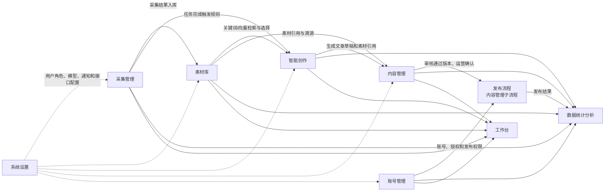

# 智媒助手前端模块设计

## 1. 设计依据

本文将 PRD 的八个一级导航映射到前端页面和用户流程，并依据 `doc/html/` 原型补充页面职责。原型是静态演示，不代表已有前端实现或接口已经接通。

前端建议使用 React + TypeScript + Vite。按业务模块组织路由、页面和状态；跨模块复用登录权限、导航布局、查询筛选、表格/空状态、通知、文件上传和异步任务展示能力。

## 2. 模块关系图



图中实线表示业务数据流或统计数据来源；虚线表示系统配置、模型配置和权限对业务模块的横向约束。工作台和统计分析读取业务模块的记录，不单独维护另一套业务状态。

## 3. 一级模块与页面

| 一级模块 | 页面/子功能 | 主要操作与数据 | 原型参考 |
| --- | --- | --- | --- |
| 工作台 | 概览、任务动态、最新文章、提醒、快捷操作 | 汇总采集/素材/创作/审核/发布数据；跳转到具体待办 | `index.html` |
| 采集管理 | 来源、任务列表/表单、采集结果、执行记录、来源健康度 | 创建/启停任务、立即采集、查看结果、单条或批量入库、忽略结果 | `collect.html` |
| 智能创作 | 自动创作规则、素材创作、主题创作、创作结果 | 配置触发和素材策略；检索、勾选素材；查看异步进度和生成结果 | `create.html`、`create-rule.html`、`create-material.html`、`create-topic.html` |
| 内容管理 | 文章列表、文章编辑、排版预览、审核队列、发布配置/记录 | 编辑版本、引用素材、提交审核、审核通过/退回/驳回、建立并确认发布单 | `content.html`、`editor.html`、`publish.html` |
| 素材库 | 素材列表、分类标签、详情抽屉、上传 | 搜索、筛选、查看来源及引用文章、归档、上传和加入创作 | `library.html` |
| 数据统计分析 | 采集、创作、发布、公众号运营指标 | 按时间、任务和账号筛选；不可获取的微信指标显示不可用 | `analytics.html` |
| 账号管理 | 公众号列表、授权详情、发布配置、素材同步 | 授权/重授权、权限检测、设置默认账号、启动同步 | `accounts.html` |
| 系统设置 | 平台、模型、用户、角色、接口、通知、操作日志 | 配置模型与基础参数、维护权限、查看脱敏后的操作记录 | `settings.html` |

“主题创作”“素材创作”“文章编辑”“审核工作台”“发布中心”属于上述模块的子页面或子流程，不新增一级导航。

## 4. 前端工程模块建议

```text
src/
  app/                 应用入口、路由、全局 provider
  shared/              API client、鉴权、布局、通用组件、格式化
  features/
    dashboard/         工作台
    collection/        采集管理
    materials/         素材库
    creation/          规则、素材创作、主题创作、任务状态
    content/           文章、版本、编辑、审核和发布
    accounts/          公众号授权与同步
    analytics/         统计报表
    settings/           系统配置、用户角色、日志
```

功能模块通过共享 API client 调用 `/api/v1`，不直接相互 import 内部数据访问逻辑。页面跳转通过路由参数传递资源 ID；跨页面共享业务数据以服务端查询缓存为准，编辑器本地状态只保存未提交变更。

## 5. 关键页面交互

- **采集结果入库**：结果详情显示来源、原文链接、发布时间、采集时间、解析/重复状态；入库后展示关联素材，不把重复候选直接当作入库成功。
- **素材检索与创作**：主题页先发起检索预览，显示来源和相关度；用户调整选择后再创建创作任务。创建完成后通过异步任务 ID 展示阶段、失败原因和重试入口。
- **文章编辑和审核**：保存创建新文章版本；审核面板针对明确版本显示检查项和审核意见。审核结论返回后更新列表状态，修改后再次提交审核。
- **发布确认**：先选择已授权且有发布权限的账号、发布方式和时间，再显示确认动作。确认成功后展示发布任务状态和尝试记录；不能只用前端 checkbox 作为发布授权事实。
- **文件操作**：前端申请受限的短期上传授权，上传到 RustFS 后通知后端登记文件；展示进度、上传失败和重试状态。
- **权限与异常**：没有权限时隐藏或禁用具体操作并显示原因；授权失效、模型不可用和异步任务失败均显示可操作的恢复路径。

## 6. 页面与 API 责任边界

- 页面列表与表单字段以 [API 设计](api-design.md) 为接口依据，业务校验和状态流转由后端执行。
- 工作台/分析页的数据来自后端聚合 API；前端不通过拼接多个静态 seed 数据计算正式指标。
- 文章引用素材、审核记录、发布订单等关系以服务端返回为准，前端不维护独立关系副本。
- 筛选参数、分页、排序和详情资源 ID 应可由 URL 表达，支持刷新和返回列表后恢复上下文。
- 数据库实体、状态、关系和权限边界见 [数据库设计](database-design.md) 与 [系统设计总览](system-design.md)。

## 7. 验收场景

- 八个一级模块可经导航到达，子页面不重复创建一级导航。
- 采集结果可入库并跳转到对应素材；素材详情能回溯采集来源及引用文章。
- 主题检索结果可人工调整；创建任务后可看到服务端任务状态，不把等待/失败显示为成功。
- 文章编辑保存新版本；旧版本审核结果不会错误地放行新版本。
- 只有后端确认审核通过、运营确认和账号权限均有效时，页面才能显示发布任务已启动。
- 刷新页面后，列表筛选、分页和任务状态可从 URL/API 恢复；加载、空、失败、无权限状态均有明确呈现。

