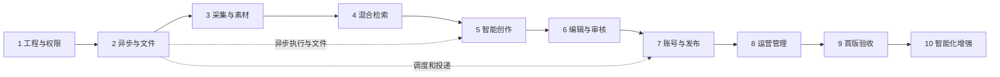

# Design

## Context

动机见 [proposal.md](proposal.md)。当前仓库主要为需求与原型文档，尚无可据以宣称业务已实现的应用代码。本计划采用 `AGENT.md` 确定的 React + TypeScript + Vite、FastAPI、PostgreSQL + pgvector、Celery + Redis、RustFS、LangGraph 方案。

依据及责任如下：

| 材料 | 使用方式 |
| --- | --- |
| [PRD](../../../doc/instruction/PRD.md) | 产品范围、业务规则、状态和三轮产品优先级 |
| [系统设计](../../../doc/architecture/system-design.md) | 后端分层、存储边界、异步执行和完整流程 |
| [前端设计](../../../doc/architecture/frontend-design.md) | 八个一级导航、页面职责、跨模块交互 |
| [数据库设计](../../../doc/architecture/database-design.md) | 迁移基线、关联、版本和约束 |
| [API 设计](../../../doc/architecture/api-design.md) | `/api/v1` 资源及通用契约 |
| `doc/html/*.html` | 具体页面字段与交互参考；其中静态 JSON 不作为真实业务记录 |
| 本变更 `specs/<capability>/spec.md` | 按能力组织的行为契约；Requirements 规定结果，Scenarios 作为测试与阶段验收输入 |

`AGENT.md` 的 `doc/instruction/介绍.md` 引用已失效，实际需求路径为 `doc/instruction/PRD.md`。本次保留已有文件改动，修正引用列入阶段 1。

### 能力规格与任务映射

本变更建立 16 份初始能力规格，均位于本变更的 `specs/` 中；在实施验收并归档前，不将其视为已实现能力或已发布的主规格。一个能力可跨多个阶段逐步交付，阶段 9 验证首版组合行为，阶段 10 的增强范围独立验收。

| 能力规格 | 主要阶段与任务 | 契约边界 |
| --- | --- | --- |
| [认证权限](specs/access-control/spec.md) | 1.4–1.9、8.5、8.9–8.10 | 身份、会话及用户角色；设置模块调用同一权限能力 |
| [应用导航](specs/application-shell/spec.md) | 1.7–1.8、2.8、各阶段页面任务、9.4 | 八模块、交互状态、刷新恢复及真实反馈 |
| [API 契约](specs/api-contract/spec.md) | 1.5、各阶段接口任务、9.3 | 字段、分页、时间、错误及异步受理 |
| [异步执行](specs/async-execution/spec.md) | 2.1–2.5、2.8、2.10、9.2、9.6 | 状态、投递、幂等和通用恢复 |
| [文件存储](specs/file-storage/spec.md) | 2.1–2.2、2.6、2.9–2.10、3.6 | 文件授权、登记、下载和原文件保留 |
| [采集管理](specs/collection-management/spec.md) | 3.1–3.2、3.4–3.7、3.9、3.11–3.12 | 任务、来源、执行、结果及入库入口 |
| [素材库](specs/material-library/spec.md) | 3.3、3.6–3.8、3.10–3.12、5.11 | 正文修订、去重、新进展、收藏和溯源 |
| [素材检索](specs/material-search/spec.md) | 4.1–4.7 | 当前正文的中文/语义检索及候选选择 |
| [智能创作](specs/ai-creation/spec.md) | 5.1–5.13 | 触发、策略、条件、生成、批次及 Agent 边界 |
| [编辑审核](specs/article-review/spec.md) | 5.3、6.1–6.10 | 文章修订、AI 编辑建议、排版和人工复审 |
| [公众号账号](specs/wechat-accounts/spec.md) | 7.1–7.4、7.10、7.12–7.13 | 接入、账号能力、默认配置及同步 |
| [可控发布](specs/controlled-publishing/spec.md) | 7.5–7.9、7.11–7.13 | 版本绑定、运营确认、发布核对及重试 |
| [工作台与统计](specs/operations-analytics/spec.md) | 8.1–8.4、8.7–8.8、8.10–8.11 | 真实聚合、指标可用性、口径及导出 |
| [平台管理](specs/platform-management/spec.md) | 2.7、5.4、5.9、8.1–8.2、8.5–8.6、8.9–8.11 | 配置、凭据、通知、操作日志和任务监控 |
| [运行与恢复](specs/service-operability/spec.md) | 1.10、2.11、各阶段验收、9.1–9.10 | 部署、故障、升级、备份和真实接入证据 |
| [智能化增强](specs/intelligence-assistance/spec.md) | 10.1–10.9 | 首版之后的推荐、关联、质量建议及效果评估 |

## Goals / Non-Goals

**Goals:** 每阶段形成能运行的纵向能力；任务包含具体产物、依赖及可观察结果；数据库和 API 补充先于对应页面联调；测试覆盖实际业务边界和失败恢复；明确首版与增强版交付边界。

**Non-Goals:** 此次不执行产品开发、不承诺工期或虚构外部权限、不把 HTML 演示当作已完成能力。`tasks.md` 中的未勾选项是后续实施工作，生成计划本身不代表这些任务已完成。

## Decisions

### 1. 按依赖拆成十个工程阶段

工程阶段细化 PRD 的三轮优先级：阶段 1–7 完成核心闭环，阶段 8 完善平台管理，阶段 9 验收并交付首版；阶段 10 属于后续智能化增强。基础模型配置、权限及日志写入提前到其业务消费者之前，完整管理页面在阶段 8 交付。

| 阶段 | 目标与主要产物 | 前置依赖 | 阶段验收标准 |
| --- | --- | --- | --- |
| 1 工程基础与认证权限 | 工程目录、运行说明、用户角色迁移、登录和导航壳、OpenAPI 基线 | 已有需求与设计文档 | 新环境按文档启动前后端及数据库；有效账号可登录、退出；四类角色的允许与拒绝行为匹配权限矩阵；八个导航入口可达，未开发页面明确标识 |
| 2 异步基础与文件存储 | Worker/Beat、outbox、任务状态、日志写入、RustFS 上传下载 | 阶段 1 | 数据事务与 outbox 同时提交；模拟 Broker 中断后恢复仍能执行且不重复业务副作用；上传完成须经后端对象校验；重启后历史状态可查 |
| 3 采集与素材闭环 | 来源及任务、采集结果、Markdown 素材修订、分类标签、收藏及文件关联 | 阶段 1–2；至少一种可接入来源或有明确标识的 fixture | 手动及定时采集可追踪执行结果；自动/人工/批量入库均可回溯来源；完全重复不重复建素材，新进展保留关联；中文正文与附件可查看；失败可重试 |
| 4 素材分块与混合检索 | pgvector 迁移、embedding 作业、关键词/向量混合搜索、主题检索预览 | 阶段 3；确定模型、维度和凭据 | 中文关键词可召回约定样例；当前修订参与默认检索；向量失败可见且可恢复；返回片段、来源和相关度，用户可调整选中素材 |
| 5 智能创作 | 规则、四种触发、三种素材策略、LangGraph 流程、生成草稿及引用 | 阶段 2–4；可用生成模型；文章基础表 | 每种触发和策略有可复现场景；条件不足记录原因且无文章；重复触发无重复产物；成功生成标题、摘要、大纲、正文等，进入待审核，具备素材版本溯源 |
| 6 编辑排版与人工审核 | 不可变文章版本、编辑器、排版手机预览、审核检查项与复审 | 阶段 5 产物及阶段 3 文件能力 | 编辑保存创建新版本；并发保存冲突可见；旧审核不能放行新版本；通过、退回、驳回和修改复审均可演示；AI 修改须由用户选择保存 |
| 7 账号授权与发布 | 公众号绑定/能力检测/同步、发布单确认、调度、attempt 历史 | 阶段 2、6；相应微信接入方式和权限 | fixture 下完整闭环通过；未审核、未确认、权限失效均被服务端阻止；定时任务执行前复验；重复请求不重复发布；外部结果未知时先核对；真实接入另有证据记录 |
| 8 工作台与运营管理 | 统计、通知、用户角色、系统/模型/接口配置、日志与监控页面 | 阶段 1–7；指标按真实能力采集 | 工作台和报表与种子业务记录对账一致；权限外指标显示不可用；导出与筛选一致；设置变更可追溯，密钥不回显；八模块均有实际业务页面 |
| 9 首版集成验收与交付 | 完整流程回归、故障恢复、迁移/备份恢复、部署运行手册 | 阶段 1–8 验收通过 | 核心正常/异常场景通过；空库迁移和已有数据升级通过；备份恢复后引用关系完整；真实外部服务完成情况有清单；未授权的真实发布不执行 |
| 10 智能化增强 | 主题推荐、深度素材关联、质量建议、复用与多账号分析 | 阶段 9；真实样本与评估口径 | 固定评估集记录推荐/检索结果及延迟，改动有前后比较；质量建议不修改人工结论；跨账号统计保留权限和可用性边界 |

采用纵向阶段而非一次做完所有前端或所有表，可以在素材入库、生成、审核等节点及早验证真实数据关系。契约稳定后，同阶段的独立页面与服务可分别实施，集成任务仍等待双方完成；图不授权自动启动多个代理。

### 2. 每项任务明确实施入口与完成条件

任务采用 `阶段号.序号`，分类为前端、后端、数据库、接口、测试或验收。阶段依赖是该阶段全部任务的公共依赖；同阶段任务另标必要前置编号。执行时按数据库/契约、领域服务、页面联调、测试及阶段验收的顺序推进，不把清单文本顺序误当唯一调度方式。

建议目录为 `frontend/`、`backend/`、`infra/`、`tests/e2e/`、`doc/`。后端采用 `api/routes → schemas → services → repositories/models`，第三方能力放 adapters，Worker 调用相同领域服务。若实施时发现已有工程，先复用其约定。

Codex 单项任务输入应包含编号、当前阶段、关联文档、已满足依赖；输出须包含改动文件、执行过的检查、可观察结果及剩余阻塞。每项任务完成后勾选，阶段验收完成前不能宣称阶段已完成。外部权限阻塞单独记录，fixture 验证和真实集成分别报告。

### 3. 先补齐契约缺口，再创建迁移和调用方

既有设计为基线而非完整 DDL/OpenAPI。阶段 1 形成页面—操作—API—实体—任务追踪矩阵，并在各阶段将以下差异同步回设计文档：

| 缺口 | 所属阶段 | 落地要求 |
| --- | --- | --- |
| 登录凭据、会话和审计字段 | 1–2 | 采用本地账号加密码哈希及可撤销会话；补 `password_hash`、会话表、禁用校验；不写入普通配置 |
| 幂等请求与运行状态 | 2 | 持久化幂等键、请求指纹和原业务响应关联；同键不同请求冲突；领域状态与运行状态分开；终态和取消结果明确 |
| 上传授权校验记录 | 2 | 记录对象键、申请人、过期时间、类型/大小限制和消费状态，完成登记防止伪造或重复关联 |
| 收藏、批量操作、删除语义 | 3 | 补用户—素材收藏关系；有关联的素材保留正文与溯源，采用归档/软删除约定，明确批量逐项结果；同步 API |
| 中文关键词与 embedding | 4 | 明确中文匹配方式和样例，不能假定默认分词满足中文；模型及维度为迁移阻塞项，保存配置版本，默认检索当前修订 |
| 创作条件不足、批次及取消/重试 | 5 | `decision_status/reason` 区分条件不满足与执行失败；保存触发窗口、批次槽位、输入修订和阶段结果；补任务列表/取消/重试/重新生成 API |
| 素材修订溯源 | 5 | `creation_task_materials` 和 `article_materials` 补实际使用的 `material_revision_id`、候选/采用标识，历史引用不随当前正文改变 |
| 乐观并发及复审 | 6 | 保存请求包含基准 revision；不匹配返回冲突；新修订再次待审核，审核原记录保持不可变 |
| 微信接入、默认账号、同步历史 | 7 | 先核实实际授权模式和回调，文档 OAuth 路径按真实方式适配；补默认账号/发布参数/解绑/同步历史接口；相关账号 FK 在本阶段约束收口 |
| 外部发布结果未知 | 7 | 不直接对超时盲目重试；保存外部标识、查询/人工核对结果，确认未发布后才可再次投递 |
| 通知读取、报表导出 | 8 | 补通知列表/已读及导出契约；明确指标分母、时区、去重口径和不可用字段 |
| 智能化增强 | 10 | 按已有增强规格细化数据设计、API 和固定评估集；新增行为再更新规格，首期检索不为增强阶段延后 |

按业务阶段创建迁移，公共父表先于引用表；创作规则目标账号在阶段 7 前不启用，届时补 FK 与界面选择。每个迁移包含非空、唯一、状态、外键和查询索引检查；不可只创建空表后把约束无限延期。

### 4. 测试逐阶段积累

使用可重复 fixture 验证采集、模型和微信边界，集成测试使用 PostgreSQL/pgvector、Redis 和 RustFS 的测试实例；禁止以 SQLite 替代关系及向量约束验收。页面测试覆盖加载、空、失败、权限及刷新恢复，业务测试覆盖并发、幂等、复审及结果未知等高风险路径。

真实来源、模型及微信调用在相应阶段凭可用配置执行连通性验证，结果包含时间、能力和脱敏证据；真实发布验证依 `AGENT.md` 必须取得明确发布授权。无权限时阶段 7 的可重复适配器验收可以完成，真实发布能力保持未验收，阶段 9 交付清单必须披露。

## Risks / Trade-offs

- [外部服务与权限未知] → 在消费者阶段设置配置/权限门槛；独立 adapter 与 fixture 保证内部工作可继续，受限能力不能标记真实完成。
- [计划覆盖整项目、执行上下文过大] → Codex 按一个任务或一个阶段执行；依赖未满足先完成依赖，跨阶段改动有明确引用。
- [原型操作比数据库/API 更完整] → 先建立追踪矩阵，缺口先更新设计与契约再写调用方；禁止以成功 toast 代替持久化。
- [数据库提交与消息投递不一致] → outbox 与业务数据同事务，dispatcher 至少一次投递，消费端通过唯一约束和事务防止重复副作用。
- [Agent 或采集正文含不可信指令] → 外部正文只作为数据，Agent 工具权限限定在检索/生成；审核、发布能力不授予 Agent。
- [修改版本后旧审核继续生效] → 审核与发布单绑定明确 revision，确认及执行重新校验当前版本。
- [大文件、Markdown 渲染及 URL 输入风险] → 明确上传边界、清理渲染内容，来源适配器限制可访问地址和超时，凭据统一脱敏。

## Migration Plan

本次只新增规划文件，无运行时迁移。后续各阶段先在独立测试数据库执行迁移；有业务数据时先备份再升级，并记录应用版本与迁移版本。首版部署含前端、API、Worker、Beat、dispatcher 和存储服务的启动、健康检查及依赖顺序。

回退优先回退应用并保持数据库向前兼容；破坏性数据变更先扩展再迁移、最后收缩，明确恢复方案。向量模型或维度升级使用新列/表重建后切换，保留旧索引到验证结束。备份恢复在阶段 9 实际演练，覆盖 PostgreSQL 与 RustFS 对象的一致性。

## Open Questions

- 具体采集来源、微信账号权限和生成/embedding 提供方由使用环境决定；在各自阶段以接入记录固定，缺失时保留阻塞项，不影响当前任务划分。
- 首版并发量、典型素材规模、检索延迟及生成耗时目标在阶段 1 记录可测基线，阶段 9 用同一数据集验证；不预设无依据的性能承诺。
