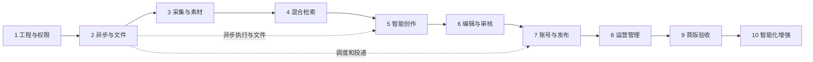

# Design

## Context

动机见 [proposal.md](proposal.md)。当前仓库已有工程、认证、异步及采集/素材基础实现，具体完成状态以任务和验证证据共同判断；本次在原路线图增补采集搜索与素材分析设计，未实现新增功能。继续采用 `AGENT.md` 确定的 React + TypeScript + Vite、FastAPI、PostgreSQL + pgvector、Celery + Redis、RustFS、LangGraph 创作方案。

依据及责任如下：

| 材料 | 使用方式 |
| --- | --- |
| [PRD](../../../doc/instruction/PRD.md) | 产品范围、业务规则、状态和三轮产品优先级 |
| [系统设计](../../../doc/architecture/system-design.md) | 后端分层、存储边界、异步执行和完整流程 |
| [前端设计](../../../doc/architecture/frontend-design.md) | 八个一级导航、页面职责、跨模块交互 |
| [数据库设计](../../../doc/architecture/database-design.md) | 迁移基线、关联、版本和约束 |
| [API 设计](../../../doc/architecture/api-design.md) | `/api/v1` 资源及通用契约 |
| `doc/html/*.html` | 具体页面字段与交互参考；其中静态 JSON 不作为真实业务记录 |
| 本变更 `specs/<capability>/spec.md` | 按能力组织的行为契约；Requirements 规定结果，Scenarios 作为测试与阶段验收输入 |

`AGENT.md` 的 PRD 引用已在任务 1.1 修正。保留已完成任务及现有工作区改动；采集增量依据 [采集增强设计](../../../doc/architecture/collection-design.md)，已有证据限制独立列于 [缺口记录](../../../doc/development/collection-enhancement-gaps.md)。

### 能力规格与任务映射

本变更建立 17 份能力规格（含新增 `material-analysis`），均位于本变更的 `specs/` 中；在实施验收并归档前，不将其视为已实现能力或已发布的主规格。一个能力可跨多个阶段逐步交付，阶段 9 验证首版组合行为，阶段 10 的增强范围独立验收。

| 能力规格 | 主要阶段与任务 | 契约边界 |
| --- | --- | --- |
| [认证权限](specs/access-control/spec.md) | 1.4–1.9、8.5、8.9–8.10 | 身份、会话及用户角色；设置模块调用同一权限能力 |
| [应用导航](specs/application-shell/spec.md) | 1.7–1.8、2.8、各阶段页面任务、9.4 | 八模块、交互状态、刷新恢复及真实反馈 |
| [API 契约](specs/api-contract/spec.md) | 1.5、各阶段接口任务、9.3 | 字段、分页、时间、错误及异步受理 |
| [异步执行](specs/async-execution/spec.md) | 2.1–2.5、2.8、2.10、9.2、9.6 | 状态、投递、幂等和通用恢复 |
| [文件存储](specs/file-storage/spec.md) | 2.1–2.2、2.6、2.9–2.10、3.6 | 文件授权、登记、下载和原文件保留 |
| [采集管理](specs/collection-management/spec.md) | 3.1–3.2、3.4–3.7、3.9、3.11–3.19、3.22、3.24–3.28 | 双模式、搜索/来源发现、范围/时间/数量、阶段恢复及入库入口 |
| [素材分析](specs/material-analysis/spec.md) | 3.14–3.16、3.20–3.28 | 结构化分析、版本与事实依据、人工保护、预算和就绪事件 |
| [素材库](specs/material-library/spec.md) | 3.3、3.6–3.8、3.10–3.12、3.15、3.19–3.23、3.25–3.28、5.11 | 正文修订、跨来源去重、新进展、收藏和溯源 |
| [素材检索](specs/material-search/spec.md) | 4.1–4.7 | 当前正文的中文/语义检索及候选选择 |
| [智能创作](specs/ai-creation/spec.md) | 5.1–5.13 | 触发、策略、条件、生成、批次及 Agent 边界 |
| [编辑审核](specs/article-review/spec.md) | 5.3、6.1–6.10 | 文章修订、AI 编辑建议、排版和人工复审 |
| [公众号账号](specs/wechat-accounts/spec.md) | 7.1–7.4、7.10、7.12–7.13 | 接入、账号能力、默认配置及同步 |
| [可控发布](specs/controlled-publishing/spec.md) | 7.5–7.9、7.11–7.13 | 版本绑定、运营确认、发布核对及重试 |
| [工作台与统计](specs/operations-analytics/spec.md) | 8.1–8.4、8.7–8.8、8.10–8.11 | 真实聚合、指标可用性、口径及导出 |
| [平台管理](specs/platform-management/spec.md) | 2.7、3.14–3.17、3.24、3.26–3.28、5.4、5.9、8.1–8.2、8.5–8.6、8.9–8.11 | 公共模型/搜索配置提前、凭据、通知、操作日志和任务监控 |
| [运行与恢复](specs/service-operability/spec.md) | 1.10、2.11、各阶段验收、9.1–9.10 | 部署、故障、升级、备份和真实接入证据 |
| [智能化增强](specs/intelligence-assistance/spec.md) | 10.1–10.9 | 首版之后的推荐、关联、质量建议及效果评估 |

## Goals / Non-Goals

**Goals:** 每阶段形成能运行的纵向能力；任务包含具体产物、依赖及可观察结果；数据库和 API 补充先于对应页面联调；测试覆盖实际业务边界和失败恢复；明确首版与增强版交付边界。

**Non-Goals:** 此次不执行产品开发、不承诺工期或虚构外部权限、不把 HTML 演示当作已完成能力。`tasks.md` 中的未勾选项是后续实施工作，生成计划本身不代表这些任务已完成。

## Decisions

### 1. 按依赖拆成十个工程阶段

工程阶段细化 PRD 的三轮优先级：阶段 1–7 完成核心闭环，阶段 8 完善平台管理，阶段 9 验收并交付首版；阶段 10 属于后续智能化增强。基础模型配置、权限及日志写入提前到其业务消费者之前，完整管理页面在阶段 8 交付。

| 阶段 | 目标与主要产物 | 前置依赖 | 阶段验收标准 |
| --- | --- | --- | --- |
| 1 工程基础与认证权限 | 工程目录、运行说明、用户角色迁移、登录和导航壳、OpenAPI 基线 | 已有需求与设计文档 | 新环境按文档启动前后端及数据库；有效账号可登录、退出；四类角色的允许与拒绝行为匹配权限矩阵；八个导航入口可达，未开发页面明确标识 |
| 2 异步基础与文件存储 | Worker/Beat、outbox、任务状态、日志写入、RustFS 上传下载 | 阶段 1 | 数据事务与 outbox 同时提交；模拟 Broker 中断后恢复仍能执行且不重复业务副作用；上传完成须经后端对象校验；重启后历史状态可查 |
| 3 采集与素材闭环 | 原采集/素材基础，加 3.13–3.28 双模式、链接发现、正文提取、公共模型及 LLM 分析 | 阶段 1–2、原基础代码；候选工具验证及所需凭据；不依赖阶段 4/5 | 原能力复验和增量独立验收通过；无来源与限定网站搜索有效、分析可恢复、跨站去重及人工保护成立；真实外部证据独立记录 |
| 4 素材分块与混合检索 | pgvector 迁移、embedding 作业、关键词/向量混合搜索、主题检索预览 | 阶段 3；确定模型、维度和凭据 | 中文关键词可召回约定样例；当前修订参与默认检索；向量失败可见且可恢复；返回片段、来源和相关度，用户可调整选中素材 |
| 5 智能创作 | 规则、四种触发、三种素材策略、LangGraph 流程、生成草稿及引用 | 阶段 2–4；可用生成模型；文章基础表 | 每种触发和策略有可复现场景；条件不足记录原因且无文章；重复触发无重复产物；成功生成标题、摘要、大纲、正文等，进入待审核，具备素材版本溯源 |
| 6 编辑排版与人工审核 | 不可变文章版本、编辑器、排版手机预览、审核检查项与复审 | 阶段 5 产物及阶段 3 文件能力 | 编辑保存创建新版本；并发保存冲突可见；旧审核不能放行新版本；通过、退回、驳回和修改复审均可演示；AI 修改须由用户选择保存 |
| 7 账号授权与发布 | 公众号绑定/能力检测/同步、发布单确认、调度、attempt 历史 | 阶段 2、6；相应微信接入方式和权限 | fixture 下完整闭环通过；未审核、未确认、权限失效均被服务端阻止；定时任务执行前复验；重复请求不重复发布；外部结果未知时先核对；真实接入另有证据记录 |
| 8 工作台与运营管理 | 统计、通知、用户角色、系统/模型/接口配置、日志与监控页面 | 阶段 1–7；指标按真实能力采集 | 工作台和报表与种子业务记录对账一致；权限外指标显示不可用；导出与筛选一致；设置变更可追溯，密钥不回显；八模块均有实际业务页面 |
| 9 首版集成验收与交付 | 完整流程回归、故障恢复、迁移/备份恢复、部署运行手册 | 阶段 1–8 验收通过 | 核心正常/异常场景通过；空库迁移和已有数据升级通过；备份恢复后引用关系完整；真实外部服务完成情况有清单；未授权的真实发布不执行 |
| 10 智能化增强 | 主题推荐、深度素材关联、质量建议、复用与多账号分析 | 阶段 9；真实样本与评估口径 | 固定评估集记录推荐/检索结果及延迟，改动有前后比较；质量建议不修改人工结论；跨账号统计保留权限和可用性边界 |

采用纵向阶段而非一次做完所有前端或所有表，可以在素材入库、生成、审核等节点及早验证真实数据关系。契约稳定后，同阶段的独立页面与服务可分别实施，集成任务仍等待双方完成；图不授权自动启动多个代理。

### 2. 每项任务明确实施入口与完成条件

任务采用 `阶段号.序号`，分类为前端、后端、数据库、接口、测试或验收。阶段依赖是该阶段全部任务的公共依赖；同阶段任务另标必要前置编号。执行时按数据库/契约、领域服务、页面联调、测试及阶段验收的顺序推进，不把清单文本顺序误当唯一调度方式。

建议目录为 `frontend/`、`backend/`、`tests/e2e/`、`doc/`，依赖服务的 `docker-compose.yml` 放在仓库根目录。后端采用 `api/routes → schemas → services → repositories/models`，第三方能力放 adapters，Worker 调用相同领域服务。若实施时发现已有工程，先复用其约定。根目录 `docker-compose.yml` 编排本地依赖服务（PostgreSQL + pgvector、Redis、RustFS），凭据从被忽略的根目录 `.env` 注入，仓库仅保留 `.env.example` 占位符。

Codex 单项任务输入应包含编号、当前阶段、关联文档、已满足依赖；输出须包含改动文件、执行过的检查、可观察结果及剩余阻塞。每项任务完成后勾选，阶段验收完成前不能宣称阶段已完成。外部权限阻塞单独记录，fixture 验证和真实集成分别报告。

### 3. 先补齐契约缺口，再创建迁移和调用方

既有设计为基线而非完整 DDL/OpenAPI。阶段 1 形成页面—操作—API—实体—任务追踪矩阵，并在各阶段将以下差异同步回设计文档：

| 缺口 | 所属阶段 | 落地要求 |
| --- | --- | --- |
| 登录凭据、会话和审计字段 | 1–2 | 采用本地账号加密码哈希及可撤销会话；补 `password_hash`、会话表、禁用校验；不写入普通配置 |
| 幂等请求与运行状态 | 2 | 持久化幂等键、请求指纹和原业务响应关联；同键不同请求冲突；领域状态与运行状态分开；终态和取消结果明确 |
| 上传授权校验记录 | 2 | 记录对象键、申请人、过期时间、类型/大小限制和消费状态，完成登记防止伪造或重复关联 |
| 收藏、批量操作、删除语义 | 3 | 补用户—素材收藏关系；有关联的素材保留正文与溯源，采用归档/软删除约定，明确批量逐项结果；同步 API |
| 中文关键词与 embedding | 4 | 明确中文匹配方式和样例，不能假定默认分词满足中文；模型及维度为迁移阻塞项，保存配置版本，默认检索当前修订 |
| 创作条件不足、批次及取消/重试 | 5 | `decision_status/reason` 区分条件不满足与执行失败；保存触发窗口、批次槽位、输入修订和阶段结果；补任务列表/取消/重试/重新生成 API |
| 素材修订溯源 | 5 | `creation_task_materials` 和 `article_materials` 补实际使用的 `material_revision_id`、候选/采用标识，历史引用不随当前正文改变 |
| 乐观并发及复审 | 6 | 保存请求包含基准 revision；不匹配返回冲突；新修订再次待审核，审核原记录保持不可变 |
| 微信接入、默认账号、同步历史 | 7 | 先核实实际授权模式和回调，文档 OAuth 路径按真实方式适配；补默认账号/发布参数/解绑/同步历史接口；相关账号 FK 在本阶段约束收口 |
| 外部发布结果未知 | 7 | 不直接对超时盲目重试；保存外部标识、查询/人工核对结果，确认未发布后才可再次投递 |
| 通知读取、报表导出 | 8 | 补通知列表/已读及导出契约；明确指标分母、时区、去重口径和不可用字段 |
| 智能化增强 | 10 | 按已有增强规格细化数据设计、API 和固定评估集；新增行为再更新规格，首期检索不为增强阶段延后 |

按业务阶段创建迁移，公共父表先于引用表；创作规则目标账号在阶段 7 前不启用，届时补 FK 与界面选择。每个迁移包含非空、唯一、状态、外键和查询索引检查；不可只创建空表后把约束无限延期。

### 4. 测试逐阶段积累

使用可重复 fixture 验证采集、模型和微信边界，集成测试使用 PostgreSQL/pgvector、Redis 和 RustFS 的测试实例；禁止以 SQLite 替代关系及向量约束验收。页面测试覆盖加载、空、失败、权限及刷新恢复，业务测试覆盖并发、幂等、复审及结果未知等高风险路径。

真实来源、模型及微信调用在相应阶段凭可用配置执行连通性验证，结果包含时间、能力和脱敏证据；真实发布验证依 `AGENT.md` 必须取得明确发布授权。无权限时阶段 7 的可重复适配器验收可以完成，真实发布能力保持未验收，阶段 9 交付清单必须披露。

### 5. 依赖服务用 Docker Compose 启动

本地开发与集成测试的 PostgreSQL + pgvector、Redis、RustFS 统一由仓库根目录 `docker-compose.yml` 定义，使用命名卷持久化并带健康检查。宿主端口经根目录 `.env` 的 `*_PORT` 变量映射，宿主标准端口被占用时改用非冲突端口，并同步更新 `DATABASE_URL`；连接串使用 `127.0.0.1` 避免本机 IPv6 解析挂起。凭据（数据库密码、RustFS 访问密钥）只写入被 `.gitignore` 忽略的 `.env`，不进入仓库、代码或演示数据。该 compose 文件属于阶段 1 任务 1.10 的运行配置交付物，提前建立以支撑迁移与认证验证；它只编排依赖服务，不替代应用进程（API/Worker/Beat/dispatcher）的启动说明。

### 6. 在原阶段 3 增补固定采集与素材分析

详细字段及规则以 [采集增强设计](../../../doc/architecture/collection-design.md)、[API](../../../doc/architecture/api-design.md)和[数据库](../../../doc/architecture/database-design.md)的增量章节为依据，均标记为待实现。首期以固定查询和有界工具调用满足主题采集，不建设自主决策的采集 Agent；固定步骤便于验证重试、成本和输入来源。创作 LangGraph 保留。

- `source` 与 `topic_search` 共用候选、抓取、正文、判重和入库；RSS/栏目必须先发现文章链接，不能把来源首页当一篇文章。阶段 4 检索仅面向已有素材，与互联网搜索分离。
- 先做规范化链接/正文 hash 防重；再用 URL/标题/关键词召回有限历史候选并按需分析，不以前置 pgvector 形成阶段 3→4→3 循环。事实提取、相关性与新进展判断保存正文依据，分析不等同事实核验。
- 模型配置表和调用能力提前到 3.15–3.16，最小配置 UI 在 3.24；阶段 4 接 embedding，5.2 不重复建表，5.4 增加文章输出校验，5.9 复用配置 UI，8.5/8.9 再完善设置。
- 默认分析关闭以兼容旧任务，启用后默认仅提供建议。失败/不确定资料保留待筛选，不能绕过就绪门槛；人工字段版本保护、独立分析重试和事务就绪事件保证可恢复、可审计。阶段 5 消费就绪事件，不让采集模块提前依赖创作表。
- 每次运行冻结配置和时间窗口，发现/抓取/分析分别计数与预算；外部调用在短事务之外执行。步骤领取和幂等保证业务不重复，不承诺外部调用恰好计费一次。
- Tavily Search/feedparser/Trafilatura 均为候选，3.13 固定中文样例并验证后确定。实际服务不可用时只记录 fixture 验证，真实验收任务保持未完成。

依赖主线为 `3.13/3.14 → 3.15 → 3.16–3.19 → 3.20–3.23 → 3.24–3.27 → 3.28 → 阶段 4 → 阶段 5`，具体执行条件以每项任务的依赖为准。原任务编号和复选框保留；3.28 是新增阶段门槛，原 3.12 的勾选不能替代。已发现原验证不足按缺口记录复验，不将新增设计反写为原实现已通过。

## Risks / Trade-offs

- [外部服务与权限未知] → 在消费者阶段设置配置/权限门槛；独立 adapter 与 fixture 保证内部工作可继续，受限能力不能标记真实完成。
- [计划覆盖整项目、执行上下文过大] → Codex 按一个任务或一个阶段执行；依赖未满足先完成依赖，跨阶段改动有明确引用。
- [原型操作比数据库/API 更完整] → 先建立追踪矩阵，缺口先更新设计与契约再写调用方；禁止以成功 toast 代替持久化。
- [数据库提交与消息投递不一致] → outbox 与业务数据同事务，dispatcher 至少一次投递，消费端通过唯一约束和事务防止重复副作用。
- [Agent 或采集正文含不可信指令] → 外部正文只作为数据，Agent 工具权限限定在检索/生成；审核、发布能力不授予 Agent。
- [修改版本后旧审核继续生效] → 审核与发布单绑定明确 revision，确认及执行重新校验当前版本。
- [大文件、Markdown 渲染及 URL 输入风险] → 明确上传边界、清理渲染内容，来源适配器限制可访问地址和超时，凭据统一脱敏。

## Migration Plan

本次仅更新规划文档，无运行时迁移。后续在当前 Alembic head 后创建增量迁移，不修改已执行的 0003/0004。旧任务回填 source、分析关闭，旧 web_page 回填文章页；保留历史正文、来源和引用，不回填虚构分析成功，不自动补跑历史任务。新字段先兼容扩展/回填后约束，API/Worker/前端支持后再启用新模式，回退应用时先停用新模式调度并保留扩展表及历史数据。本地依赖服务继续由根目录 Docker Compose 启动；在独立测试数据库验证升级、回退兼容及恢复，不以删库重建代替迁移。

回退优先回退应用并保持数据库向前兼容；破坏性数据变更先扩展再迁移、最后收缩，明确恢复方案。向量模型或维度升级使用新列/表重建后切换，保留旧索引到验证结束。备份恢复在阶段 9 实际演练，覆盖 PostgreSQL 与 RustFS 对象的一致性。

## Open Questions

个人订阅号已确认采用草稿交付后人工发布。增加独立 wechat_draft_deliveries/attempts，复用安全排版和图片转换，但不进入 freepublish 链路。草稿读取成功仅代表可尝试写入，未知写入结果先按已持久化内容核对，不盲目重试。人工发布登记带明确来源与内容一致声明；详见 [直连设计](../../../doc/architecture/wechat-direct-design.md)。

阶段 7 接入方式已由用户于 2026-11-19 确定为自有公众号直连。具体契约、权限探测边界、轮询核对及无 OAuth 回调设计见 [微信直连设计](../../../doc/architecture/wechat-direct-design.md)。账号连接、素材同步与发布分别验证；不以连接成功证明发布权限。

- 采集搜索/解析候选及 analysis 模型的正式选择在 3.13 记录；中文目标来源覆盖、配额费用、真实权限仍需实测。配置未固定前不得宣称本增强可真实使用。

- 具体采集来源、微信账号权限和生成/embedding 提供方由使用环境决定；在各自阶段以接入记录固定，缺失时保留阻塞项，不影响当前任务划分。
- 首版并发量、典型素材规模、检索延迟及生成耗时目标在阶段 1 记录可测基线，阶段 9 用同一数据集验证；不预设无依据的性能承诺。

### 阶段8落地设计

工作台/报表/导出复用真实事实查询，指标口径、日期时区、人工登记及草稿隔离、通知防重/偏好/权限、平台配置和运行管理的具体决策见 `doc/architecture/operations-design.md`。采用0021迁移；文本模型/搜索复用已有配置，向量/存储的运行期密钥沿用部署环境，网页不回显。站内通知以持久事实和唯一事件键投递，邮件/微信外发未接入。

### 阶段9规模验证实现补充

检索使用数据库词项GIN候选与binary HNSW近似语义候选（1024位，m=8、ef_construction=32），再以原始1024维向量余弦和词项分数重排。候选数有界，不再在Python读取全库正文/向量；过滤仍限定当前有效修订、配置版本及成功向量执行。近似语义候选须在结果说明标识，并在阶段9记录合成数据构造和召回质量边界。列表采用稳定分页复合索引、批量标签读取和同步数据库处理线程，性能结论仅使用数据灌入完成后的受控测量。

部署分runtime与acceptance构建target；正式镜像不包含外部模拟适配器。就绪探测分数据库迁移head、Broker、桶，存活接口保持兼容。未知发布/草稿只允许核对结果，超时回收不能重放外部提交；outbox人工恢复仅限原作业仍pending。联合恢复使用新库与新桶，保留原应用密钥并校验历史链与对象哈希。

年规模验证发现重复向量会使全分块HNSW候选漏召回。0023将图索引移至按模型配置/版本及原向量SHA-256去重的向量表，并以事务触发器维护分块映射，保留全部原向量和修订。查询先检索共享向量，再关联当前有效且生成成功的分块；索引表自身不代表可引用素材。固定样例验证多个素材共享向量、删除原分块及配置变化后的召回和隔离。性能报告同时列出原始分块向量数和索引唯一向量数，不将高重复合成语料的结果泛化为同等数量互异向量的性能。

年规模列表计数采用 0024 的事务维护计数表：素材新增、软删除、恢复、物理删除及清空时同步更新，回滚同样撤销计数。仅无筛选列表使用该精确计数，筛选统计仍按实际条件计算；数量变化的并发写入会竞争计数行，应监测高写入负载。
